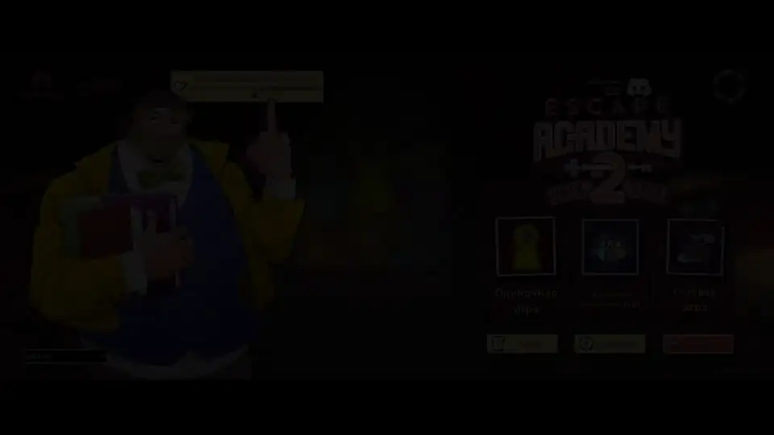
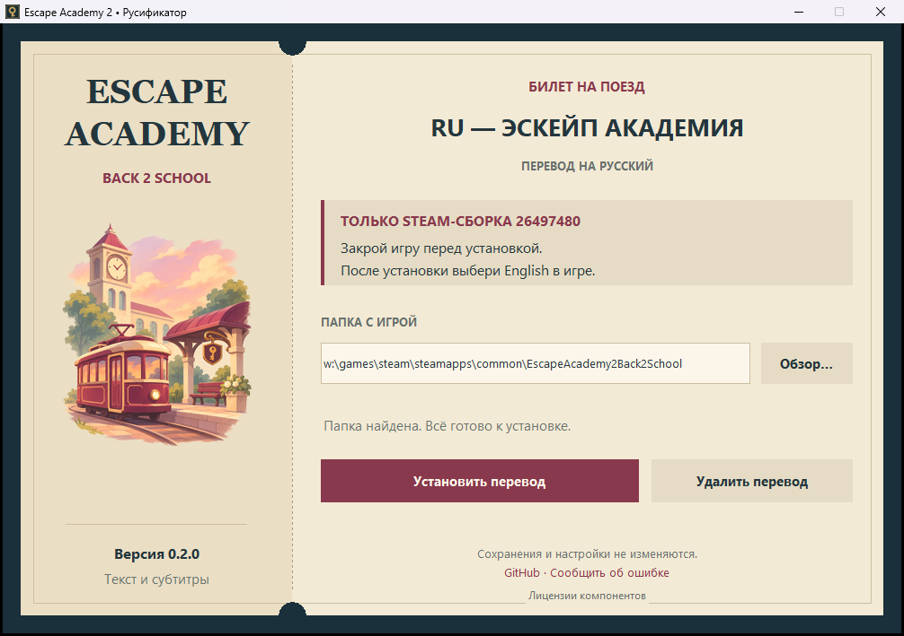

# Русификатор Escape Academy 2: Back 2 School

> [!WARNING]
> **Перевод пока не прошёл игровое тестирование. Полное прохождение только в планах.**
> Проверен базовый вывод кириллицы, но это не подтверждает проходимость загадок.
> Возможны ошибки перевода, **хардлоки и софтлоки**. Если столкнётесь с проблемой,
> [создайте Issue](https://github.com/docwitson/Escape-Academy-Back-2-School-Russian-Translation/issues/new/choose):
> укажите комнату, сборку игры, версию русификатора и приложите скриншот.

| Что проверяется | Статус |
| --- | --- |
| Основная кампания с переводом | **Не пройдена, не проверена** |

Неофициальный русский перевод текста и субтитров Steam-версии для Windows.
Перевод получен через Gemini 3.8 Flash High и частично отредактирован.
Это не профессиональная вычитка. Английские коды и слова-ответы местами сохранены
намеренно. Надписи, нарисованные на текстурах, не переводились.

## Демонстрация

[](docs/media/EscapeAcademy2Rus.mp4)

[Открыть трейлер в MP4](docs/media/EscapeAcademy2Rus.mp4) — 40 секунд, со звуком.

## Скачать

**[Скачать установщик из Releases](https://github.com/docwitson/Escape-Academy-Back-2-School-Russian-Translation/releases/tag/v0.2.0)**



## Совместимость

| Параметр | Поддерживается |
| --- | --- |
| Русификатор | 0.2.0 |
| Steam build ID | **26497480** |
| Платформа | Windows x64 |
| Язык в настройках игры | **English** |

Если игра обновилась, необходимо откатиться либо дождаться совместимого выпуска.
Или сообщите об этом в Issues.

## Установка и удаление

1. Закройте игру и запустите EXE.
2. Проверьте найденную папку Steam или выберите её через «Обзор».
3. Нажмите **«Установить перевод»** и дождитесь завершения.
4. В игре выберите **English**.

Для удаления закройте игру и нажмите **«Удалить перевод»** в том же установщике.
Сохранения и настройки не изменяются. Оригиналы ресурсов сохраняются в
`.ea2-russian/<build>/original` в папке игры. Старые резервные копии после обновления
не перезаписываются.

## Сообщить о проблеме

При хардлоке, софтлоке, неверной подсказке, пропавшем диалоге или квадратиках вместо
букв создайте [Issue](https://github.com/docwitson/Escape-Academy-Back-2-School-Russian-Translation/issues/new/choose).
Нужны место/комната, шаги воспроизведения, скриншот, версия игры и русификатора.
Если загадка связана с вводом ответа — напишите, что пытаетесь ввести.
Игровые архивы и полный сценарий прикладывать не нужно.

## Сборка из исходников

Для сборки из исходников нужны Windows и Python 3.11:

```powershell
python -m pip install -r requirements-build.txt
.\build.ps1
python -m unittest discover -s tests
```

Код: [MIT](LICENSE.md). Русский текст: [CC BY-NC-SA 4.0](LICENSE-TRANSLATION.md)
в пределах прав участников проекта. Escape Academy и игровые материалы принадлежат
их правообладателям; проект неофициальный и не одобрен разработчиками.

[Русификатор первой Escape Academy](https://github.com/docwitson/Escape-Academy-Russian-Translation)
